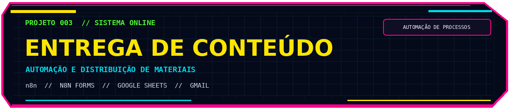
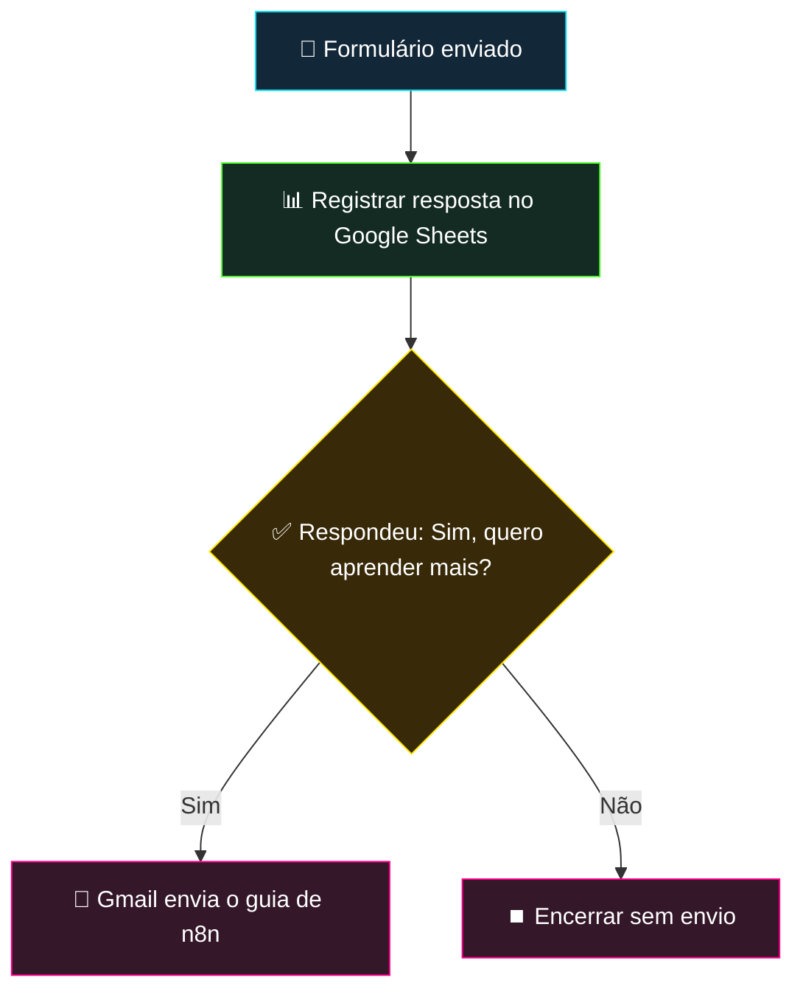
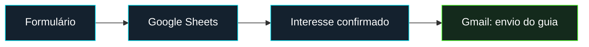
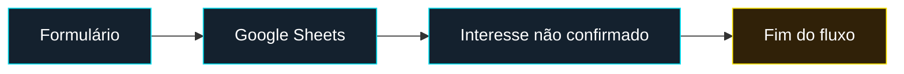

# 📩 Entrega Automatizada de Conteúdo

### Captação, organização e distribuição de materiais com fluxos condicionais no n8n

  
  
  
  

**Do preenchimento do formulário ao envio de um guia por e-mail — automaticamente e conforme o interesse do usuário.**

---

## 01 // Visão geral

A **Entrega Automatizada de Conteúdo** é uma solução desenvolvida durante a imersão **Jornada de Dados** para organizar respostas recebidas por formulário e enviar materiais relevantes de acordo com o interesse declarado por cada pessoa.

Com o **n8n** orquestrando o processo, os dados são registrados no **Google Sheets** e uma condição determina se o usuário receberá um **guia de automações com n8n por e-mail**, enviado pelo **Gmail**.

O projeto demonstra a integração de ferramentas, a automação de rotinas repetitivas e o uso de regras de negócio para direcionar ações sem intervenção manual.

## 02 // Problema e solução

Distribuir conteúdo manualmente exige acompanhar formulários, organizar cadastros e conferir quais pessoas solicitaram determinado material.

A automação centraliza esse processo em um único fluxo:

| Etapa | Resultado |
|---|---|
| Captação | Usuário preenche o formulário do n8n |
| Organização | As respostas são registradas no Google Sheets |
| Validação | Uma condição verifica a resposta de interesse |
| Entrega | Gmail envia o guia para quem respondeu **“Sim, quero aprender mais”** |
| Encerramento | Quando a condição não é atendida, o fluxo termina sem envio |

## 03 // Arquitetura da solução

O fluxo segue uma sequência simples: **captar → registrar → verificar → agir**.

### Componentes da automação

| Nó do n8n | Responsabilidade |
|---|---|
| **On form submission** | Inicia a execução quando o formulário é enviado |
| **Append row in sheet** | Adiciona as respostas à planilha do Google Sheets |
| **If** | Avalia a condição de interesse em receber o material |
| **Send a message (Gmail)** | Dispara o e-mail com o guia quando a condição é verdadeira |
| **No Operation, do nothing** | Finaliza o ramo em que a condição não foi atendida |

## 04 // Funcionamento na prática

### Cenário A — Usuário quer receber o guia

1. A pessoa preenche e envia o formulário.
2. O n8n grava suas respostas na planilha.
3. A condição identifica **“Sim, quero aprender mais”**.
4. O Gmail envia automaticamente o guia de automações com n8n.

### Cenário B — Usuário não solicita o guia

1. A pessoa preenche e envia o formulário.
2. O n8n grava suas respostas na planilha.
3. A condição não é atendida.
4. O fluxo encerra a execução sem enviar o material.

## 05 // Tecnologias utilizadas

| Tecnologia | Aplicação no projeto |
|---|---|
| **n8n** | Orquestração do fluxo e execução das condições |
| **n8n Forms** | Captura das respostas do formulário |
| **Google Sheets** | Armazenamento centralizado das informações |
| **Gmail** | Envio automatizado do guia aos interessados |

## 06 // Decisões técnicas

**Registro antes da decisão.** A resposta é salva no Google Sheets antes da verificação de interesse. Assim, o registro de submissões não depende do envio do material.

**Separação entre cadastro e entrega.** A captação de dados e o envio de conteúdo têm responsabilidades próprias, conectadas por uma condição simples e explícita.

**Roteamento condicional.** O nó `If` determina se o Gmail será acionado. A decisão segue uma regra de negócio objetiva, sem necessidade de intervenção manual.

**Integrações nativas.** O uso dos nós do n8n para Google Sheets e Gmail simplifica a comunicação entre serviços e a manutenção do fluxo.

---

